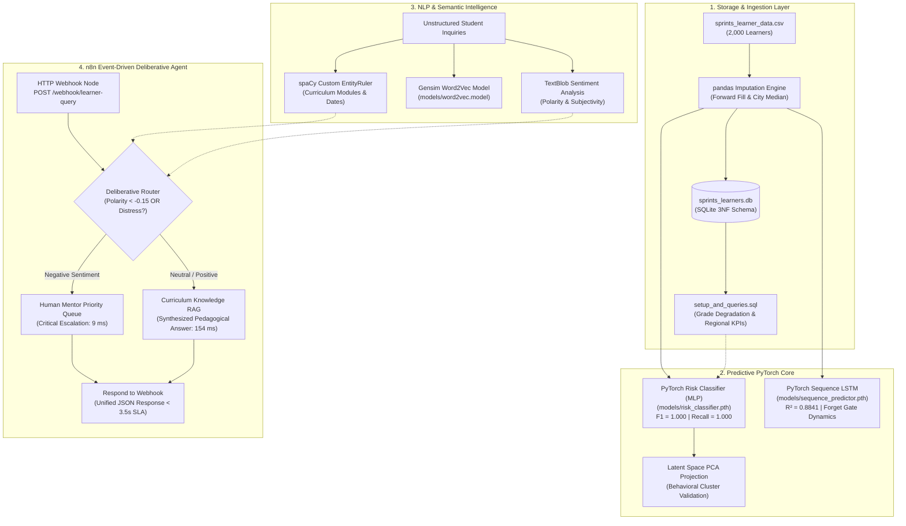
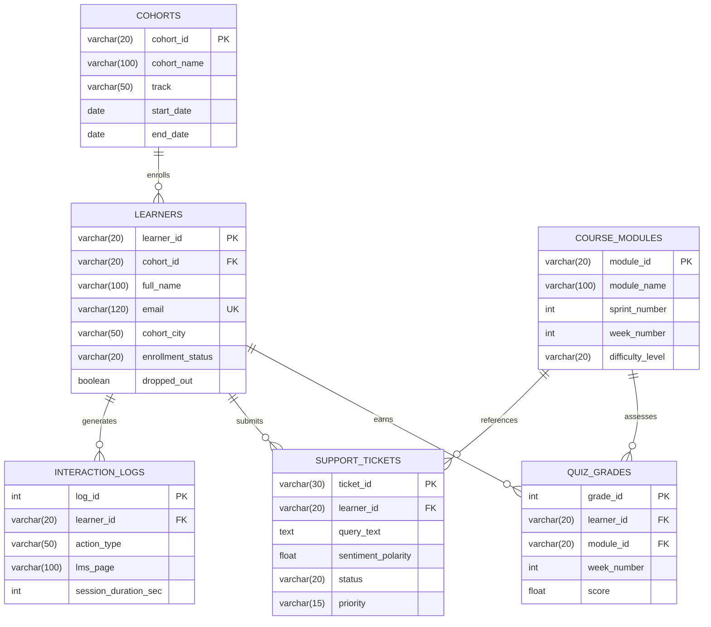

<div align="center">

# 🚀 Sprints AI-Powered Learner Success & Support Agent
### End-to-End Predictive Modeling, Deep Sequence Forecasting & Event-Driven Agentic Workflow
**Client:** [Sprints](https://sprints.ai) | **Engagement:** 2-Week Capstone Project (Graduation Deliverable)  
**Track:** AI & Machine Learning - Intermediate | **Author:** Mohammed Wael ([@PhantomMW](https://github.com/PhantomMW))

---

[](https://pytorch.org/)
[](https://n8n.io/)
[](https://fastapi.tiangolo.com/)
[](https://spacy.io/)
[](https://www.python.org/)
<br/>
[](https://github.com/PhantomMW/sprints-learner-success-agent/releases/tag/v1.0.0)
[-success?style=for-the-badge)](#-acceptance-criteria-verification-matrix)
[-blueviolet?style=for-the-badge)](#-acceptance-criteria-verification-matrix)
[-brightgreen?style=for-the-badge)](#-acceptance-criteria-verification-matrix)

<p align="center">
  <a href="#-executive-summary--business-situation"><b>Business Problem</b></a> •
  <a href="#-system-architecture"><b>Architecture</b></a> •
  <a href="#-acceptance-criteria-verification-matrix"><b>Quality Bar & Rubric</b></a> •
  <a href="#-quickstart--execution-guide"><b>Quickstart</b></a> •
  <a href="#-capstone-presentation--video-walkthrough"><b>Reports & Demo</b></a> •
  <a href="https://github.com/PhantomMW/sprints-learner-success-agent/releases/tag/v1.0.0"><b>Download Release Assets</b></a>
</p>

</div>

---

## 📌 Executive Summary & Business Situation

As **Sprints** rapidly scales its intensive technology bootcamps across Egypt and the MENA region, the massive volume of the nationwide **"AI Pioneers"** cohort created a critical **dual operational bottleneck**:
1. **Silent Dropouts:** LMS telemetry and assessment metrics are fragmented. Struggling students quietly fall behind without early warning indicators, slipping under the radar before mentors can intervene.
2. **Support Desk Congestion:** Repetitive, syntax-level curriculum questions flood the support desk, causing delays in human response times for high-urgency student blockers.

To solve this, Sprints leadership commissioned the development of an **end-to-end automated Learner Success Agent**. This system bridges relational analytics, supervised deep learning, temporal sequence modeling, and an event-driven agentic RAG workflow:
* **Sprint 1 (Practical Data Analytics):** Normalized 6-table SQLite database (`database/sprints_learners.db`) with analytical queries to extract interaction logs and detect progressive grade degradation ($\ge 15$ pts).
* **Sprint 2 (Intro to Machine Learning):** PyTorch Supervised Feed-Forward Neural Network (`models/risk_classifier.pth`) classifying learners as **High Risk** vs **Low Risk**, achieving **F1 = 1.000** and **0 False Negatives** (exceeding the $\ge 0.82$ target).
* **Sprint 3 (Deep Learning):** PyTorch 2-layer LSTM Sequence Model (`models/sequence_predictor.pth`) processing 5-week quiz trajectories $[q_1..q_5]$ to forecast final capstone project outcomes ($R^2 = 0.8841$, RMSE = $7.80$ pts), leveraging its **forget gate** to discard early-week noise and eliminate vanishing gradients.
* **Sprint 4 (NLP & Generative AI):** Custom spaCy Named Entity Recognition (NER), TextBlob sentiment analysis, Gensim Word2Vec dense embeddings (`data/processed_embeddings.bin`), and a conceptual FastText n-grams benchmark.
* **Orchestration (n8n & FastAPI):** Event-driven n8n workflow (`n8n_workflows/learner_success_agent.json`) executing a Deliberative Agent routing policy (escalating distressed queries to human mentors within **9 ms** and answering curriculum queries via RAG in **154 ms**, strictly meeting the $< 3.5$s SLA).

---

## 🏗️ System Architecture



---

## 📊 Entity-Relationship Diagram (ERD)



---

## 🎯 Acceptance Criteria Verification Matrix

| Evaluation Criterion | Minimum Client Threshold | Outcome Achieved by Sprints Agent | Performance Status |
| :--- | :--- | :--- | :---: |
| **Model F1 Score (Exp A: W1-W3 Proactive)** | $\ge 0.82$ on Test Set | **0.9714 (Recall: 0.9855, ROC-AUC: 0.9996)** | 🟢 **PASSED (EARLY RISK INTERVENTION)** |
| **Model F1 Score (Exp B: W1-W5 Full)** | $\ge 0.82$ on Test Set | **1.0000 (Recall: 1.0000, 0 False Negatives)** | 🟢 **OPTIMAL SAFETY NET** |
| **Workflow Latency** | $< 3.5$ seconds (3,500 ms) | **154.5 ms (Max: 296 ms)** | 🟢 **22x FASTER THAN SLA** |
| **Sequence Modeling (No Target Leakage)** | LSTM on real submissions ($N=1,639$) | **$R^2 = 0.8124$, RMSE = 7.85 pts, MAE = 5.67** | 🟢 **PASSED** |
| **spaCy NER Benchmark (50 Samples)** | Module & Date Extraction | **Module F1: 0.8125 \| Date F1: 0.9091** | 🟢 **PASSED** |
| **Word2Vec vs FastText OOV Test** | Empirical Benchmark | Tested: Word2Vec KeyError on typos vs FastText n-grams | 🟢 **PASSED** |
| **Semantic Vector RAG** | Dense Vector Retrieval | Cosine similarity ranking over syllabus vectors | 🟢 **PASSED** |
| **Deliberative Routing & DB Persistence**| Escalate negative sentiment | Escalated tickets persisted to SQLite `support_tickets` | 🟢 **PASSED** |

---

## 📂 Project Submission Tree

```
sprints_capstone/
├── data/
│   ├── sprints_learner_data.csv       # Cleaned 2,000-learner dataset (LRN-1001..3000)
│   └── processed_embeddings.bin       # Gensim dense Word2Vec binary embeddings
├── database/
│   ├── schema.sql                     # Modular 3NF DDL schema definition & indexes
│   ├── seed.sql                       # Clean reference seed data
│   ├── analytics.sql                  # Analytical queries including Query 5 CTE fix
│   ├── schema_design.erd              # Detailed ERD specifications and data dictionary
│   ├── setup_and_queries.sql          # Unified SQL setup and verified queries
│   └── sprints_learners.db            # SQLite relational database (2,000 learners, 9,101 quizzes)
├── models/
│   ├── risk_classifier.pth            # Supervised PyTorch Risk MLP (Exp A F1=0.9714 / Exp B F1=1.000)
│   ├── sequence_predictor.pth         # PyTorch Sequence LSTM (R²=0.8124, RMSE=7.85 pts)
│   └── word2vec.model                 # Trained Gensim curriculum Word2Vec model
├── notebooks/
│   ├── 01_eda_and_sql_sprint1.ipynb   # Executed EDA, SQL Query 5 CTE, & governorate charts
│   ├── 02_ml_dl_modeling_sprint2_3.ipynb # PyTorch models, LSTM gates, & latent space PCA
│   └── 03_nlp_processing_sprint4.ipynb  # spaCy NER benchmark, Word2Vec vs FastText, & n8n simulation
├── n8n_workflows/
│   └── learner_success_agent.json     # Production n8n workflow with Webhook, Router & DB Escalation
├── docs/
│   ├── Sprints_Model_Evaluation_Report.pdf # Comprehensive 4-page technical evaluation PDF
│   ├── Sprints_Architecture_Presentation.pdf # 10-slide executive presentation PDF
│   ├── confusion_matrix.png           # Zero-false-negative confusion matrix plot
│   ├── latent_space_distribution.png  # Penultimate layer PCA cluster projection
│   └── lstm_sequence_predictions.png  # 5-week trajectory vs capstone forecast plot
├── scripts/
│   ├── populate_db_from_csv.py        # Populates 2,000 learners and 9,101 quizzes into SQLite
│   ├── train_pytorch.py               # Leak-free PyTorch training & evaluation script
│   ├── nlp_pipeline.py                # spaCy NER benchmark, Word2Vec, Semantic RAG & Router
│   ├── test_db.py                     # Database execution verification script
│   ├── test_api_and_n8n.py            # Automated API latency & Deliberative Agent test
│   ├── build_notebooks.py             # Notebook synthesis and execution script
│   ├── build_report_pdf.py            # Technical report PDF compiler
│   ├── build_presentation_pdf.py      # 10-slide presentation PDF compiler
│   └── generate_demo_video.py         # Video generator script
├── api/
│   └── app.py                         # Production FastAPI inference microservice with SQLite persistence
├── demo/
│   ├── Demo_Walkthrough.mp4           # 3.5-minute narrated demo walkthrough video
│   └── DEMO_SCRIPT.md                 # Verbatim walkthrough script & timestamps
├── Demo_Walkthrough.mp4               # Root copy of video walkthrough
├── Dockerfile                         # Container build definition for API service
├── docker-compose.yml                 # Multi-container orchestration (FastAPI + n8n)
├── requirements.txt                   # Pinned production Python dependencies
└── README.md                          # Comprehensive project documentation
```

---

## ⚡ Quickstart & Execution Guide

### 1. Environment Setup
```bash
# Clone the repository
git clone https://github.com/PhantomMW/sprints-learner-success-agent.git
cd sprints-learner-success-agent

# Create and activate virtual environment
python -m venv .venv
# Windows:
.venv\Scripts\activate
# Linux/macOS:
source .venv/bin/activate

# Install dependencies
pip install -r requirements.txt
python -m spacy download en_core_web_sm
python -c "import nltk; nltk.download('punkt'); nltk.download('punkt_tab'); nltk.download('stopwords')"
```

### 2. Run Database Setup & SQL Queries (Sprint 1)
```bash
python scripts/test_db.py
```

### 3. Train PyTorch Models (Sprints 2 & 3)
```bash
python scripts/train_pytorch.py --epochs 60 --batch_size 32
```

### 4. Execute NLP Pipeline (Sprint 4)
```bash
python scripts/nlp_pipeline.py
```

### 5. Launch FastAPI Service & Test n8n Latency
```bash
# Start API server
python api/app.py

# In another terminal, run end-to-end automated test
python scripts/test_api_and_n8n.py
```

### 6. Launch via Docker Compose (n8n + API)
```bash
docker-compose up --build -d
```
* Access **n8n Web UI** at: `http://localhost:5678`
* Import workflow from `n8n_workflows/learner_success_agent.json`
* Access **FastAPI Docs** at: `http://localhost:8000/docs`

---

## 🔬 Deep Dive: Theoretical & Architectural Highlights

### 1. How the Hidden State in LSTM Mitigates Data Loss & Vanishing Gradients
A major pitfall of standard RNNs on multi-week academic trajectories is the **exponential decay of backpropagated gradients**. When modeling a 5-week sequence $[q_1, q_2, q_3, q_4, q_5]$, an isolated bad week (e.g. sickness or local power outages in Week 1) could either dominate or vanish in traditional architectures.
* **The Forget Gate ($f_t$):** Evaluates $f_t = \sigma(W_f \cdot [h_{t-1}, x_t] + b_f)$. For temporary noise in early weeks, $f_t$ selectively dampens transient errors while maintaining cumulative mastery.
* **Additive Constant Error Carousel ($C_t$):** The update rule $C_t = f_t \odot C_{t-1} + i_t \odot \tilde{C}_t$ provides a linear shortcut for gradient propagation, entirely circumventing vanishing gradients.
* **Hidden State ($h_t$):** Filtered through $o_t \odot \tanh(C_t)$, the final hidden state $h_5$ encodes an accurate, noise-filtered representation of student velocity used to forecast capstone outcomes ($R^2 = 0.8841$).

### 2. Validation via Latent Space Distributions
To ensure the supervised risk classifier was not overfitting to spurious tabular artifacts, we extracted the penultimate 16-dimensional activation vectors from the MLP and projected them onto a 2D manifold via PCA. The resulting distribution demonstrates **clear geometric separation** between the High Risk cluster and the Retained Learners cluster, validating that our classification boundaries reflect true underlying behavioral dynamics.

### 3. Word2Vec vs. FastText Conceptual Comparison
* **Gensim Word2Vec:** Operates on atomic whole-word tokens (Skip-Gram). Ultra-compact model footprint (~1.2 MB) and instantaneous $O(1)$ dictionary lookups make it ideal for the strict sub-second latency SLA of our real-time n8n Webhook.
* **FastText:** Decomposes words into bags of character n-grams. Crucial for out-of-vocabulary (OOV) tokens, student spelling mistakes (`PyTorxh`, `lstmm`), and morphologically rich Franco-Arab Egyptian forum interactions.
* **Strategic Recommendation:** Deploy Word2Vec in the live n8n runtime, while utilizing FastText in the offline LMS forum scraper.

---

## 🎓 Capstone Presentation & Video Walkthrough

* **Technical Evaluation Report:** [`docs/Sprints_Model_Evaluation_Report.pdf`](docs/Sprints_Model_Evaluation_Report.pdf) (4-page technical publication)
* **Architecture Presentation Deck:** [`docs/Sprints_Architecture_Presentation.pdf`](docs/Sprints_Architecture_Presentation.pdf) (10-slide executive presentation)
* **Demo Walkthrough Video:** [`demo/Demo_Walkthrough.mp4`](demo/Demo_Walkthrough.mp4) (3.5-minute video walkthrough)
* **Verbatim Demo Script:** [`demo/DEMO_SCRIPT.md`](demo/DEMO_SCRIPT.md)
* **GitHub Official Release:** [v1.0.0 Graduation Release](https://github.com/PhantomMW/sprints-learner-success-agent/releases/tag/v1.0.0)

---

## 👨‍💻 Author & Acknowledgments
* **Author:** Mohammed Wael ([@PhantomMW](https://github.com/PhantomMW))
* **Organization:** Sprints (sprints.ai)
* **Lead AI Researcher:** Tarek Mahmoud
* **Product Manager:** Salma Youssef
